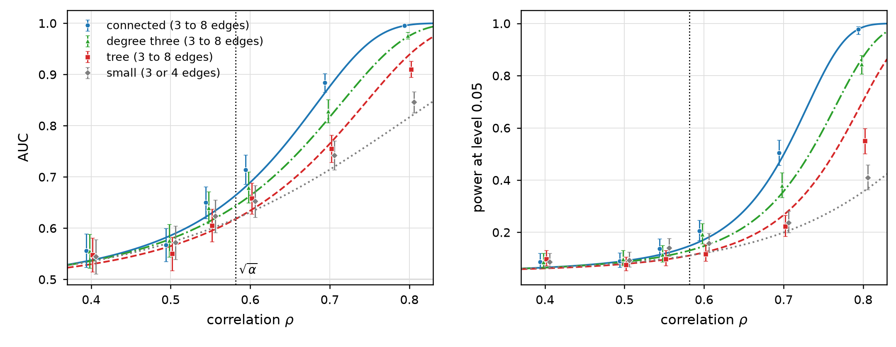

# Bounded-degree motif correlation tests

Code and summary data for the numerical experiments in **Testing Correlation in Graphs by Counting Bounded Degree Motifs**, by **Dong Huang and Pengkun Yang**.

The figure numbers below follow the November 2026 manuscript. The repository reproduces Figures 4-8 in Section 5. The simulation engine evaluates signed injective motif counts by exact combinatorial formulas in float64 arithmetic. The manuscript's asymptotic color-coding algorithm is a separate theoretical construction and is not implemented here.

## Reproduce the paper figures

Clone the repository, then run:

```bash
git clone https://github.com/donghuang-stat/bounded-degree-code.git
cd bounded-degree-code
python3 -m venv .venv
source .venv/bin/activate
python -m pip install -r requirements-figures.txt
python plot_paper.py
```

This redraws the figures from the included summary tables and computes the family cardinalities for Figure 8. It takes seconds to tens of seconds on a laptop, including the first font-cache initialization. It does not launch the simulation campaigns.

Outputs are `figures/paper/figure4.png` through `figure8.png`, together with vector PDFs. Figure 8 also exports `family_counts.csv`, `signal_growth.csv`, and its computational metadata.

```bash
python plot_paper.py --figures 4 7
python plot_paper.py --data-dir data/paper --out-dir figures/paper
python signal_growth.py --max-edges 30 --out-dir figures/paper
```



## Experiments in the manuscript

| Figure | Graph size | Motif edge range | Content |
|---|---:|---|---|
| 4 | 500 | 3-8 | AUC and power at p=0.5, near Otter's threshold |
| 5 | 500 | 3-8 | AUC for four edge probabilities |
| 6 | 5,000 | 3-5 | AUC for four edge probabilities |
| 7 | 10,000 | 3-4 | AUC for four edge probabilities |
| 8 | Analytic family counts | 3-30 | Per-size signal scores and Gaussian AUC predictions, with the available n=500 empirical points |

Each of the three simulation campaigns uses:

- `p = 0.01, 0.05, 0.2, 0.5`;
- alternative correlations `rho = 0, 0.1, 0.2, 0.3, 0.4, 0.5, 0.55, 0.6, 0.7, 0.8, 0.9, 0.99`;
- 1,200 independent null pairs per p and 400 alternative pairs per rho: **24,000 graph pairs per campaign**.

The first two zeros in the configuration's `rhos` list have distinct roles: index 0 is the shared null sample, and index 1 is an independent alternative control with rho=0. They must remain separate.

The principal families are all connected motifs (`ALL`), motifs of maximum degree at most three (`DEG3`), all trees (`TREE`), and the three-or-four-edge baseline. Their sizes are:

| Campaign | ALL | DEG3 | TREE | Small baseline |
|---|---:|---:|---:|---:|
| n=500, 3-8 edges | 356 | 156 | 92 | 8 |
| n=5000, 3-5 edges | 20 | 16 | 11 | 8 |
| n=10000, 3-4 edges | 8 | 7 | 5 | 8 |

For Figure 7, ALL and the small baseline are the same family and are drawn once. The generic analysis also provides cycle-family diagnostics.

## Statistical and computational method

The two input graphs have marginal distribution G(n,p). Under the null they are independent; under the alternative their corresponding edges have correlation rho. The latent correspondence is set to the identity because the statistic is invariant under relabeling either graph separately.

Let B_j = A_j - p(J-I), with zero diagonal. The count `inj(M, B_j)` sums the product of edge weights over injective maps of a motif M into the graph. For a family F, the statistic is

$$
T_F = \sum_{M\in F} \rho^{e(M)}
\frac{(n-v(M))!}{n!\,[p(1-p)]^{e(M)}\,\mathrm{aut}(M)}
\mathrm{inj}(M,B_1)\mathrm{inj}(M,B_2).
$$

The simulations use the true p and rho. At rho=0, the analysis uses the weights for rho=0.5 to obtain a nontrivial null comparison. For a single edge size, the rho factor is common to all motifs and does not change the ROC ordering.

For rho>0, with weights matched to that rho, the exact moments give `E0[T_F]=0`, `Var0[T_F]=S_F` and `E1[T_F]=S_F`, where `S_F=sum_M rho^(2e(M))`. The rho=0 control uses the fixed rho=0.5 weights: its mean is zero and its null variance is `S_F(0.5)`, while the tables report `S_F(0)=0` to mark the control. The smooth overlay curves are **Gaussian predictions**, not exact finite-sample AUC or power formulas:

$$
\mathrm{AUC}_{\mathrm{Gaussian}}=\Phi(\sqrt{S_F/2}),\qquad
\mathrm{power}_{\mathrm{Gaussian}}=1-\Phi(z_{0.95}-\sqrt{S_F}).
$$

Empirical AUC intervals use the DeLong variance estimator; paired comparisons use the same graph pairs. Power is evaluated using the empirical 95% quantile of the first 600 null pairs, with Type I error evaluated on the other 600. Power intervals use Wilson's formula. The saved summary tables contain Type I point estimates.

`motiflib.py` enumerates motifs up to isomorphism using pynauty. It evaluates injective counts by Moebius inversion over independent-set partitions, then shares the resulting matrix computations in one DAG. Quotients of treewidth at most two use O(n^3) operations; the treewidth-three branch fixes one vertex and uses O(n^4) operations. The supported simulation range is **3-9 edges**; the manuscript campaigns stop at eight. These are exact combinatorial evaluations with floating-point roundoff, rather than randomized count approximations or arbitrary-precision arithmetic.

DEG3, TREE and CYCLE are selected during aggregation. The simulator still computes all connected motifs in the configured edge range. Centering also makes B dense even when the original graph is sparse.

For Figure 8, `signal_growth.py` independently computes the number of isomorphism classes by Burnside's lemma and an Euler transform, and computes tree numbers from Otter's generating-function identities. It does not count occurrences of 30-edge motifs inside simulated graphs. The cardinalities are checked against [OEIS A002905](https://oeis.org/A002905). The infinite-tree Gaussian AUC reference at rho=0.55 is approximately **0.5970486562**. See [Figure 8](docs/figures/figure8.png).

## Run a small simulation

Install the counting dependency as well:

```bash
python -m pip install -r requirements.txt
PYTHON=python bash run_local.sh configs/test_pipeline.json 2
python monitor.py configs/test_pipeline.json --final
python tests/check_outputs.py configs/test_pipeline.json
```

`pynauty` may need a C compiler and GNU make if a compatible binary wheel is unavailable. The scripts support Python 3.8 and later; the prepared release was tested locally with Python 3.12, NumPy 2.5.4, SciPy 1.18.1, Matplotlib 3.11.2 and pynauty 2.8.8.1. Exact version pins for that environment are in `requirements-tested-py312.txt`.

## Re-run a full campaign on Slurm

Full simulation is substantially more expensive than redrawing the figures. The three original campaigns together consumed approximately **6,125 allocated CPU hours**, including allocation overhead. Runtime depends on the hardware, process layout and BLAS threading.

| Figure | Campaign configuration |
|---|---|
| 4-5 | `campaigns/n500_m38.json` |
| 6 | `campaigns/n5000.json` |
| 7 | `campaigns/n10000_m34.json` |

Make the Python environment available on compute nodes using the marked environment block in `slurm/run_array.sbatch`. Account and partition settings can be supplied through the usual `SBATCH_ACCOUNT` and `SBATCH_PARTITION` variables. For example, submit a selected campaign with 16 concurrent four-worker shards:

```bash
CPUS=4 ARRAY_TIME=02:00:00 ARRAY_MEM_PER_CPU=8G \
  bash slurm/submit_campaign.sh campaigns/n500_m38.json 16

python monitor.py campaigns/n500_m38.json
python monitor.py campaigns/n500_m38.json --plots
```

The generic array runner uses one BLAS thread per worker. Use `bench.py` on the intended compute nodes to select memory, worker count and shard time. An n-by-n float64 matrix alone needs `8*n*n` bytes, and the evaluator holds several such matrices per worker. Increasing worker count multiplies memory usage. A single matrix product is not distributed across nodes; different graph pairs and shards provide cluster parallelism.

```bash
python bench.py --config configs/n500_m38_p05.json --pairs 1 --workers 1
```

Every completed pair is checkpointed. Repeating the same submission command skips completed shards and resumes unfinished ones. Keep the configuration's seed, layout and output directory unchanged when resuming. Use a new output directory for a different design. `DRY_RUN=1` prints submission commands for inspection.

## Data and reproducibility

The included `data/paper/` contains the summary, paired-comparison, graph-check, null-moment and motif-description CSVs for all twelve simulation configurations. Their checksums and sample sizes are recorded in [the data manifest](data/paper/manifest.json). These tables reproduce the manuscript's numerical values and figure error bars without re-running the simulations. [Data documentation](data/paper/README.md) describes their scope.

Raw pairwise counts and graph adjacency matrices are not bundled. A simulation produces raw `shard_*.npz` files and merges them into `analysis/all_pairs.npz`. The latter contains the two graphs' signed motif counts, rho index, replicate index, edge counts and per-pair elapsed time. With `save_graphs=false`, graphs are reproduced from their configuration and seed:

```bash
python graphs.py configs/n500_m38_p05.json 7 0
```

A pair's generator is initialized with `SeedSequence([seed, n, rho_idx, rep])`. Changing shard size or execution order in a new output directory preserves the pair identities. Bitwise agreement is tested within a fixed software and BLAS environment; floating-point reductions can differ across environments.

The historical `sec` and `cpu_sec` fields measure **elapsed wall seconds per pair**, not summed process CPU time. In particular, the legacy `manifest.json` field `cpu_hours_total` sums those wall times. For allocated CPU hours, use the scheduler's allocated CPU count times elapsed job time.

## Tests

```bash
python -m unittest discover -s tests -p 'test_*.py' -v
PYTHON=python bash tests/test_local_campaign.sh
PATH="$PWD/tests/mock_slurm:$PATH" PYTHON=python \
  bash tests/test_slurm_small.sh campaigns/test_small.json
```

The unit tests include independent brute-force checks of all 356 motifs with 3-8 edges on small signed graphs, the treewidth-three and chunked branches, exact family cardinalities through 30 edges, manuscript figure values, and plotting/launcher regressions. The end-to-end tests send real SIGTERM and SIGKILL signals, resume checkpoints, and compare results after changing shard layout and execution order. The Slurm mock tests submission and dependency handling locally; `tests/test_slurm_small.sh` with its default campaign uses a real cluster.

The shell tests reset their own test output directories. Supply only a disposable test campaign to the Slurm test script.

## Main files

| File | Role |
|---|---|
| `motiflib.py` | Motif enumeration and exact signed count evaluation |
| `run_shard.py` | Seeded sampling, shard execution and per-pair checkpoints |
| `aggregate.py`, `plots.py` | Statistics, uncertainty estimates and per-configuration plots |
| `monitor.py`, `campaign_plot.py` | Campaign progress, merged tables and plots |
| `plot_paper.py` | Figures 4-8 from included summaries and analytic family counts |
| `signal_growth.py` | Exact family cardinalities and Figure 8 |
| `graphs.py`, `bench.py` | Regeneration and resource measurements |
| `configs/`, `campaigns/` | Paper designs and small test designs |
| `slurm/`, `tests/` | Portable submission scripts and validation |

## Citation and license

Please cite the accompanying manuscript if you use the code or data:

```bibtex
@unpublished{huang_yang_bounded_degree_motifs,
  author = {Huang, Dong and Yang, Pengkun},
  title  = {Testing Correlation in Graphs by Counting Bounded Degree Motifs},
  year   = {2026},
  note   = {Manuscript}
}
```

Repository citation metadata is in `CITATION.cff`. Original project code and the included research summary data are provided under the [MIT License](LICENSE). Dependencies retain their own licenses; see [third-party notices](THIRD_PARTY_NOTICES.md).
